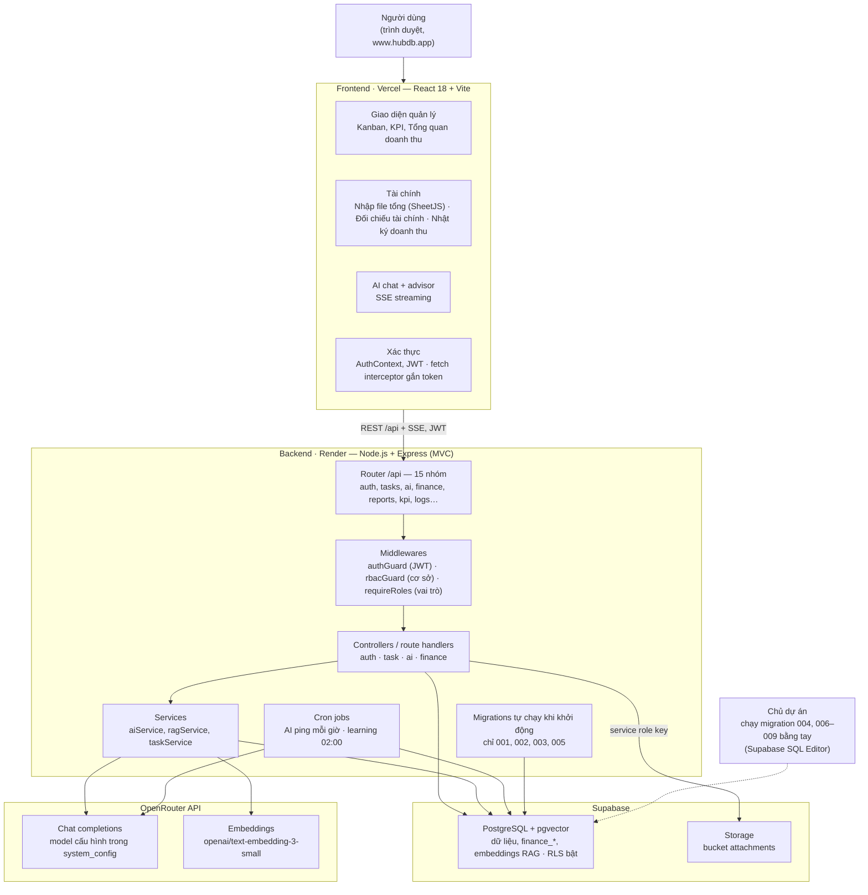
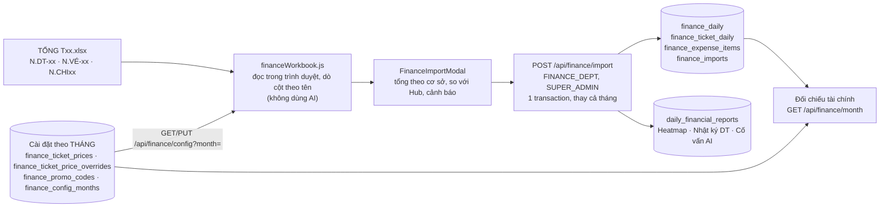

# Kiến trúc hệ thống — TaskFlow (hub-dubai)

> File này mô tả kiến trúc tổng thể của ứng dụng để con người và AI agents nắm nhanh bối cảnh.
> Cập nhật file này khi thay đổi cấu trúc lớn (thêm tầng, đổi hosting, thêm service ngoài).

## Sơ đồ tổng quan

### Luồng nhập file tổng tháng (kế toán)

## Các tầng chính

### 1. Frontend — `frontend/` (deploy: Vercel, tên miền `www.hubdb.app`)
- **Stack**: React 18 + Vite, axios, react-markdown. SheetJS 0.18.5 nạp qua CDN (`window.XLSX`, khai báo trong `index.html`).
- **API base**: `frontend/src/api/apiBase.js` và `axiosClient.js` — ưu tiên `VITE_API_URL`, fallback `https://taskflow-ai-dashboard.onrender.com`.
- **Xác thực**: `frontend/src/contexts/AuthContext.jsx` — JWT lưu ở localStorage (`taskflow_token`, `taskflow_auth`). Đầu `App.jsx` có **fetch interceptor toàn cục** tự gắn `Authorization` cho mọi request tới `/api/` và đẩy về `/login` khi gặp 401; `axiosClient` cũng gắn token.
- **Không gọi Supabase trực tiếp**: mọi upload đi qua backend (`frontend/src/utils/uploadFile.js` → `/api/upload/attachment`). Gói `@supabase/supabase-js` còn trong `package.json` nhưng không dùng.
- **AI streaming**: `frontend/src/hooks/useAIChatStream.ts` và `useAIStream.js` — nhận SSE từ `/api/ai/chat`.
- **Tài chính**:
  - `RevenueOverviewDashboard` (Tổng quan doanh thu) — nút **Nhập dữ liệu**: file `.xlsx` → `utils/financeWorkbook.js` + `FinanceImportModal`; ảnh/CSV vẫn qua AI (`/api/internal/extract-revenue*`).
  - `FinanceReconciliation` (Đối chiếu tài chính) — kết quả theo cơ sở, vé theo loại, dịch vụ & tiền dư, khuyến mãi theo cơ sở, chi theo loại/từng khoản, theo ngày, hàng bán kèm, lịch sử nhập, cài đặt giá/mã KM.
  - `RevenueLog` (Nhật ký doanh thu) — sửa doanh thu có lý do, lưu vào `edit_history`.
  - `services/dataService.js` — `fetchReports` thêm bí danh camelCase (`totalRevenue`, `createdBy`, `editHistory`) cho dữ liệu snake_case từ API.
- **Components khác**: `GlobalKanban`, `FacilityDashboard`, `AIAdvisor`, `AIChatBox`, `HeatmapKPI`, `KPISettings`, `DailyRevenueReport`, `RAGManagerPanel`, `AdminConfigPanel`, `AIInsightsManager`, `DailyCheckin`…
- **Menu theo vai trò**: khai báo trong `App.jsx` (khối `NavItem` theo `user.role`) và điều kiện render theo `activeTab` — chỉ là lớp giao diện; quyền thật phải chặn ở backend.
- **SPA routing**: `vercel.json` rewrite toàn bộ về `index.html`.

### 2. Backend — `backend/` (deploy: Render)
- **Stack**: Node.js + Express 4, mô hình MVC trong `backend/src/`.
- **Entry**: `backend/server.js` — khi khởi động: (1) chạy các migration trong mảng `migrationFiles`, (2) nạp cron jobs, (3) mount router tổng `/api`.
- **Routes** (`backend/src/routes/index.js`): 15 nhóm — `/auth`, `/tasks`, `/ai`, `/facilities`, `/kpi`, `/logs`, `/reports`, `/checkin`, `/ai-ping`, `/config`, `/users`, `/rag`, `/internal`, `/upload`, `/finance`.
- **Middlewares**:
  - `authGuard.js` — xác thực JWT, gắn `req.user` (`role`, `facility_id`, `is_global_access`).
  - `rbacGuard.js` — chặn theo **cơ sở** (facility_id), SUPERVISOR chỉ được xem.
  - `requireRoles.js` — chặn theo **vai trò**: `requireRoles('FINANCE_DEPT', 'SUPER_ADMIN')`, dùng sau `authGuard`, trả 403.
- **Controllers**: `authController.js`, `taskController.js`, `aiController.js`; các route mới (finance, reports, kpi) xử lý trực tiếp trong file route.
- **Services**: `aiService.js`, `ragService.js`, `taskService.js`.
- **Cron jobs** (`backend/src/cron/`):
  - `aiPingJob.js` — chạy mỗi giờ (`0 * * * *`).
  - `aiLearningJob.js` — chạy 02:00 hằng ngày (`0 2 * * *`), "trí nhớ dài hạn": trích xuất bài học vào bảng `ai_learned_insights`.

### 3. Dữ liệu — Supabase
- **PostgreSQL**: kết nối qua `pg` Pool (`backend/src/config/database.js`, dùng `DATABASE_URL`). Backend ghi trực tiếp nên các bảng mới bật RLS không kèm policy để chặn truy cập qua API công khai của Supabase.
- **pgvector**: embeddings cho RAG trong `ragService.js` (toán tử `<=>`, ngưỡng similarity > 0.3 chống hallucination).
- **Storage**: bucket `attachments` — upload qua `/api/upload/attachment` (multer memory → `supabaseAdmin.js` với service role key).
- **Bảng cấu hình**: `system_config` chứa API key + model AI (cache 5 phút trong `aiController.js`).
- **Doanh thu & tài chính**:

| Bảng | Nội dung | Ghi bởi |
|---|---|---|
| `daily_financial_reports` | 1 dòng/ngày, `data` = mảng doanh thu từng cơ sở, `edit_history` = lịch sử sửa | `POST /api/reports`, `POST /api/finance/import` |
| `finance_imports` | mỗi lần nhập file tổng: tháng, file, người nhập, tổng, cảnh báo | `/api/finance/import` |
| `finance_daily` | ngày × cơ sở: số vé, khách, doanh thu, chi, quẹt thẻ, hàng bán kèm (`addons`) | `/api/finance/import` |
| `finance_ticket_daily` | ngày × cơ sở × loại vé × mã KM × KM: số vé, khách, thực thu, vé 0 đồng | `/api/finance/import` |
| `finance_expense_items` | từng khoản chi: ngày, cơ sở, nội dung, số tiền, loại chi phí | `/api/finance/import` |
| `finance_config_months` | tháng nào đã có bộ cài đặt riêng (`copied_from` = tháng nguồn khi tự sao chép) | `PUT /api/finance/config`, `/api/finance/import` |
| `finance_ticket_prices` | theo tháng: loại vé (`kind=ticket`, giá chung) hoặc dịch vụ (`kind=service`, chỉ tên) | `PUT /api/finance/config` |
| `finance_ticket_price_overrides` | theo tháng: giá riêng theo cơ sở (vd SK) — ưu tiên hơn giá chung | `PUT /api/finance/config` |
| `finance_promo_codes` | theo tháng: tên chương trình theo mã ở cột Code | `PUT /api/finance/config` |

- **Cài đặt theo tháng**: mỗi tháng một bộ giá vé / dịch vụ / giá riêng / mã KM. Tháng chưa có bộ riêng dùng tháng gần nhất trước đó; `POST /api/finance/import` tự sao chép thành bộ riêng của tháng được nhập. Sửa cài đặt tháng này không đổi giảm ước tính hay tên chương trình của tháng khác — cần cho so sánh và dự đoán theo thời gian.
- **Quy ước file tổng** (xem `financeWorkbook.js`): hậu tố sheet `01` = cơ sở PAK; tinh dầu, khăn, đồ uống là hàng bán kèm, **không** tính doanh thu; dòng có tiền mà không ghi loại vé là **tiền dư**; loại `kind=service` (MS, LG) là **dịch vụ** — cả hai tính doanh thu nhưng không đếm vé/khách; KM `HH` là kênh môi giới, không phải giảm giá.

### 4. AI — OpenRouter
- **Chat completions**: `https://openrouter.ai/api/v1/chat/completions` — model cấu hình động trong `system_config`, đổi qua Admin panel.
- **Embeddings**: `https://openrouter.ai/api/v1/embeddings` — model `openai/text-embedding-3-small`, phục vụ RAG.

## Phân quyền ghi dữ liệu (backend)

| API | Ai được dùng |
|---|---|
| `/api/logs` (GET/POST/PUT) | mọi người đã đăng nhập |
| `POST /api/reports` (ghi/sửa doanh thu) | `FINANCE_DEPT`, `SUPER_ADMIN` |
| `POST /api/kpi` | `SUPER_ADMIN`, `FINANCE_DEPT`, `VICE_PRESIDENT` |
| `POST /api/finance/import`, `PUT /api/finance/config` | `FINANCE_DEPT`, `SUPER_ADMIN` |
| `GET /api/finance/*` | `SUPER_ADMIN`, `VICE_PRESIDENT`, `FINANCE_DEPT`, `DEPARTMENT_HEAD` |
| `POST /api/config`, `/api/users` | chỉ cần đăng nhập — chưa chặn vai trò (đã biết, đang gác lại) |

## Luồng request điển hình

1. **CRUD task**: Frontend → `axiosClient` (JWT) → `/api/tasks` → `authGuard` → `rbacGuard` → `taskController` → `taskService` → PostgreSQL.
2. **AI chat (RAG)**: Frontend → `/api/ai/chat` → `aiController` → `ragService` tạo embedding câu hỏi (OpenRouter) → tìm vector tương đồng (pgvector) → ghép context → gọi chat completions (OpenRouter) → stream SSE về client.
3. **Upload file**: Frontend → `/api/upload/attachment` (multipart) → multer → Supabase Storage → trả public URL.
4. **Nhập file tổng tháng**: kế toán chọn `.xlsx` → `financeWorkbook.js` đọc trong trình duyệt → xem trước + cảnh báo → `POST /api/finance/import` → `requireRoles` → transaction thay dữ liệu tháng trong `finance_*` và cập nhật `daily_financial_reports`.
5. **Học tự động**: `aiLearningJob` (02:00) đọc dữ liệu hoạt động → gọi LLM trích xuất insights → lưu `ai_learned_insights` → hiển thị trong `AIInsightsManager`.

## Migrations

| File | Tự chạy khi khởi động? | Ghi chú |
|---|---|---|
| `001`, `002`, `003`, `005` | Có (mảng `migrationFiles` trong `server.js`) | |
| `004_add_edit_history_to_daily_logs.sql` | Không | đã chạy tay (kiểm tra 2026-10-28: cột có, 27/5.416 dòng có lịch sử sửa) |
| `006_add_edit_history_to_daily_financial_reports.sql` | Không | đã chạy tay (2026-10-28) |
| `007_finance_workbook_import.sql` | Không | đã chạy tay — tạo bảng `finance_*`, nạp giá + mã KM |
| `008_finance_service_types.sql` | Không | đã chạy tay — `kind`/`name`, MS, LG là dịch vụ |
| `009_finance_price_overrides.sql` | Không | đã chạy tay — giá SK theo cơ sở |
| `010_finance_config_per_month.sql` | Không | chạy tay một lần — cài đặt tách theo tháng, gán cài đặt cũ cho 2026-10 |

**Không** thêm 007–010 vào `migrationFiles`: chúng nạp dữ liệu cấu hình (giá, tên dịch vụ, giá riêng SK); chạy lại mỗi lần khởi động sẽ ghi đè/khôi phục những gì kế toán đã sửa trên Hub.

## Triển khai

- Cả Vercel và Render **tự deploy từ nhánh `main`** (backend mất khoảng 5 phút). Không có CI.
- Thay đổi cần cột/bảng mới: **chạy migration trên Supabase trước, rồi mới merge** — backend mới sẽ lỗi nếu thiếu bảng.
- Không có route health/version; muốn biết bản mới đã lên thì kiểm tra hành vi (vd gọi API không token phải trả 401).

## Biến môi trường quan trọng

| Biến | Nơi dùng | Ý nghĩa |
|---|---|---|
| `DATABASE_URL` | backend | Connection string PostgreSQL (Supabase) |
| `SUPABASE_URL`, `SUPABASE_SERVICE_ROLE_KEY` | backend | Storage admin |
| `SECRET_KEY` | backend | Ký JWT (`authGuard.js`, `authController.js`) |
| `DEFAULT_AI_MODEL` | backend | Model AI fallback |
| `PORT` | backend | Mặc định 5000 |
| `VITE_API_URL` | frontend | URL backend |

## Ghi chú cho agents

- Code backend "chuẩn" nằm trong `backend/src/` — các file `fix*.js`, `patch_*.py/js`, `test_*.js`, `old_server.js` ở thư mục gốc và `backend/` là file tạm/thử nghiệm, **không phải** source chính.
- `backend/server.js` là entry point hiện hành; `backend/old_server.js` và `server.js.backup` là bản cũ.
- Menu và điều kiện hiển thị tab ở frontend **không phải** lớp bảo mật — mọi API ghi dữ liệu phải chặn bằng `requireRoles` / `rbacGuard` ở backend.
- API `/api/reports` trả cột snake_case (`total_revenue`, `created_by`, `edit_history`, `timestamp` là chuỗi số); đọc qua `fetchReports` trong `dataService.js` để có bí danh camelCase.
